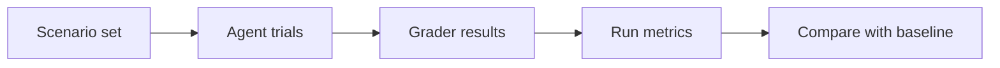

# SynthArena

Regression tests for AI agents: repeated trials, graders, and cost and latency for every run.

`TypeScript` `pnpm` `Turborepo` `Vitest` `Next.js`

> One of four projects on running AI agents safely: [AgentHub](https://github.com/asquitt/agent-hub) · [AgentGuard](https://github.com/asquitt/agent-guard) · [AgentTrace](https://github.com/asquitt/agent-trace) · **SynthArena**

## Overview

An agent finishing a task once in a demo tells you very little. When you change a prompt, a model, or a tool, you want to know which tasks got better, which got worse, and what it cost.

SynthArena runs an agent through a set of scenarios several times, scores each run with configurable graders, and compares the results against a baseline. It points out new failures that an improved average score would hide.

## Features

- **Scenarios.** Load them from files, generate them from templates, and check their quality before use. See [`packages/scenarios`](packages/scenarios/).
- **Composable graders.** Check content, token/cost/latency limits, state changes, and policy rules, or use a model as a judge. See [`graders.ts`](packages/core/src/graders.ts).
- **Repeated trials.** Run each scenario more than once and aggregate the results, so one lucky run doesn't count as a pass. See [`evaluate.ts`](packages/core/src/evaluate.ts).
- **Regression diffs.** Compare two runs to find new failures plus changes in cost and latency. See [`regression.ts`](packages/replay/src/regression.ts).
- **Cost estimates.** Estimate token costs from configured model prices. See [`packages/cost`](packages/cost/).

## How it works



Each scenario runs against the agent several times. Graders score every trial, the results roll up into run metrics, and the regression step compares those metrics with a saved baseline.

## Quick start

Requires Node.js 22+ and pnpm 9.15.0.

```bash
git clone https://github.com/asquitt/synth-arena.git
cd synth-arena
pnpm install --lockfile=false --ignore-scripts
```

The committed lockfile is out of date with the package manifests, so `--lockfile=false` resolves dependencies fresh without rewriting it.

## Running tests

```bash
pnpm test:core
pnpm test:scenarios
```

Good starting points are the [grader tests](packages/core/src/graders.test.ts), [scenario loader tests](packages/scenarios/src/loader.test.ts), and [regression tests](packages/replay/src/regression.test.ts), read alongside their source files.

## Project structure

```text
packages/core/        graders, evaluation loop, red-team presets
packages/scenarios/   scenario loading, generation, and quality checks
packages/replay/      regression comparison and trace import
packages/cost/        token cost estimates
packages/shared/      shared types
packages/sdk-ts/      TypeScript client
apps/api/             API server
apps/cli/             command-line runner
apps/web/             Next.js lab UI
```

## Status

- SynthArena is internal evaluation tooling, not a standalone product or hosted service. Its release status is on hold, as recorded in [`PROJECT_STATUS.json`](PROJECT_STATUS.json).
- A grader score only means something under that grader's rules. It doesn't prove an agent is reliable in general. Model-based graders and cost estimates depend on how you configure them.

## Author

Built by [Demario Asquitt](https://github.com/asquitt). Small reproducible scenarios and grader failure cases make the best issues.
